# IoT Smart Energy Monitoring System

A serverless smart-meter pipeline on AWS. Simulated meters publish voltage, current and power factor over MQTT. The cloud backend computes power and cost, flags electrical faults, stores every reading, emails alerts, and serves the data through a REST API.

**Live dashboard:** https://energy-dashboard-lyart.vercel.app/
**Dashboard code:** https://github.com/joshua2007godwin/energy-dashboard

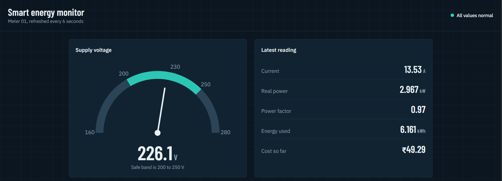

## Architecture

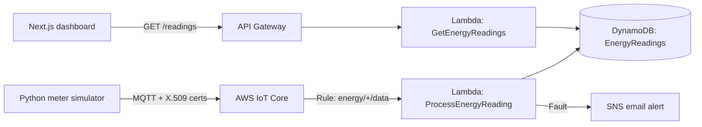

## What the backend does

- Authenticates each meter with its own certificate, and an IoT policy that only allows connecting as `meter-*` and publishing to `energy/*`
- Computes real power (kW = V x I x PF / 1000) and cost per reading
- Flags faults and stores every reading with its alert list
- Sends an SNS email when a fault is detected
- Exposes `GET /readings?deviceId=meter-01&limit=40` through an HTTP API with CORS enabled

## Fault rules

| Fault | Condition |
| --- | --- |
| Overvoltage | Voltage above 250 V |
| Undervoltage | Voltage below 200 V |
| Overload | Current above 20 A |
| Low power factor | Power factor below 0.85 |

## Repository layout

```
lambda/       ProcessEnergyReading and GetEnergyReadings (Python 3.12)
simulator/    Meter simulator that publishes over MQTT
iam/          Least-privilege IAM policies and the IoT device policy
iot/          IoT Core rule SQL
docs/         Screenshots
```

## Screenshots

### Dashboard

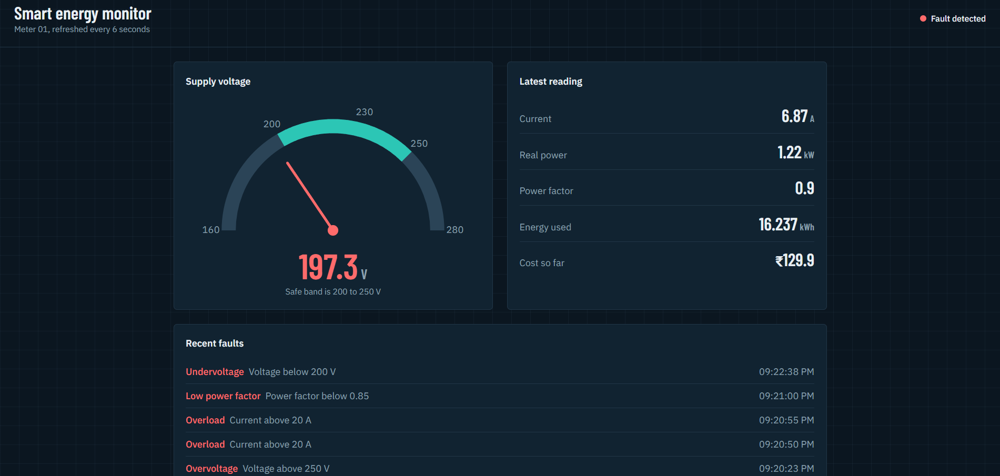
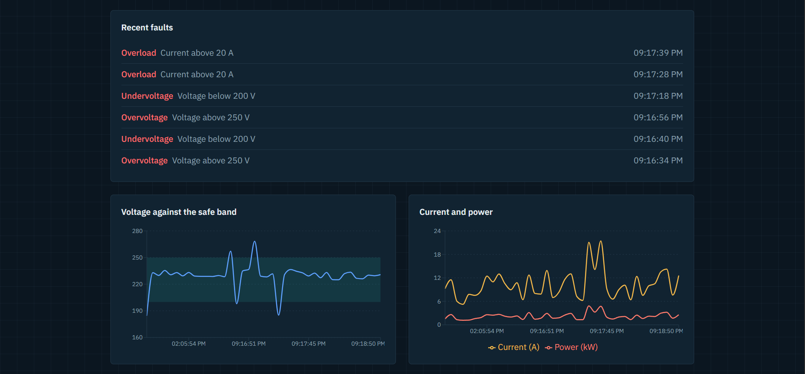

### AWS setup

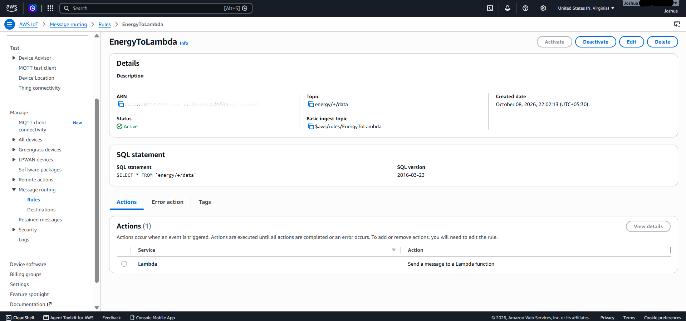
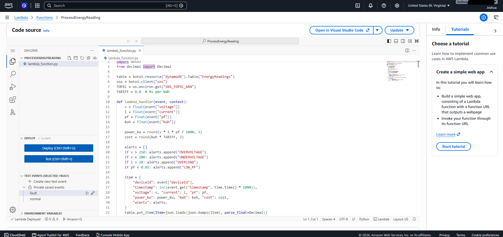
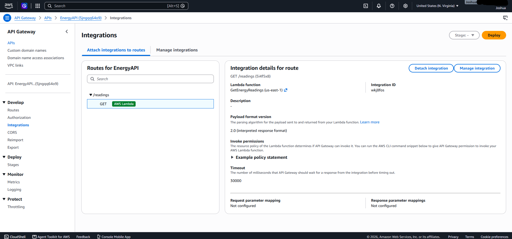
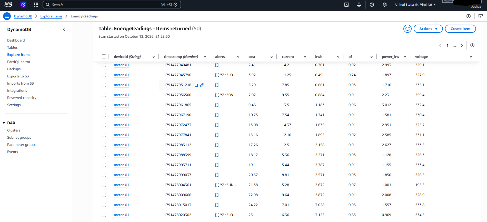

### Alerts and simulator

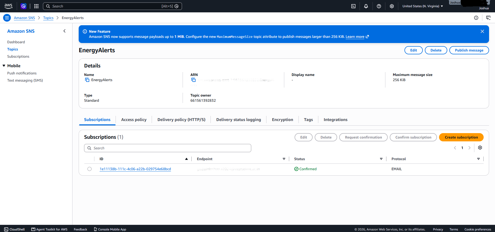
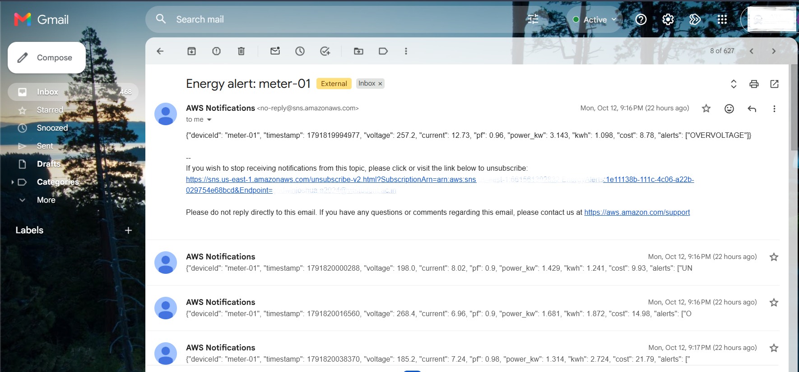
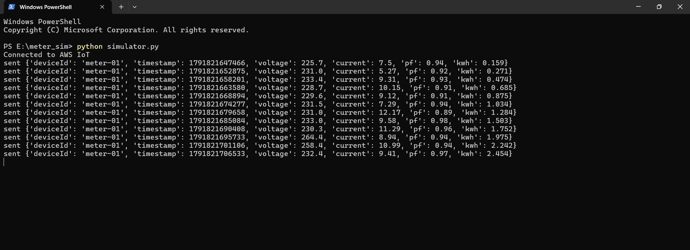

## Setup (AWS console, region us-east-1)

1. **DynamoDB:** create table `EnergyReadings`, partition key `deviceId` (String), sort key `timestamp` (Number), on-demand capacity.
2. **Lambda:** create `ProcessEnergyReading` from `lambda/process_energy_reading.py`. Attach `iam/energy-put-item.json` and `iam/energy-sns-publish.json` to its role, and set the environment variable `SNS_TOPIC_ARN`.
3. **SNS:** create topic `EnergyAlerts` and confirm an email subscription.
4. **IoT Core:** create thing `meter-01` with an auto-generated certificate, attach the policy from `iam/meter-policy.json`, and create a rule using `iot/rule.sql` with a Lambda action pointing at `ProcessEnergyReading`.
5. **Read API:** create Lambda `GetEnergyReadings` from `lambda/get_energy_readings.py` with `iam/energy-query.json`, then an HTTP API with route `GET /readings` and CORS allowing GET.
6. **Simulator:**
```bash
   pip install awsiotsdk
```
   Put the device certificate, private key and Amazon Root CA 1 in `simulator/certs/` as `device.pem.crt`, `private.pem.key` and `AmazonRootCA1.pem`. Set `ENDPOINT` in `simulator.py` to your IoT device data endpoint, then run:
```bash
   python simulator.py
```

## Security notes

- Certificates and private keys are git-ignored and must never be committed.
- IAM policies grant only the actions each function needs, scoped to its resource.
- Each meter's IoT policy limits it to `meter-*` clients and the `energy/*` topics.

## Tech stack

AWS IoT Core, Lambda, DynamoDB, SNS, API Gateway, CloudWatch, Python, MQTT

## Author

Joshua, B.Tech Electrical and Electronics Engineering, VIT Chennai